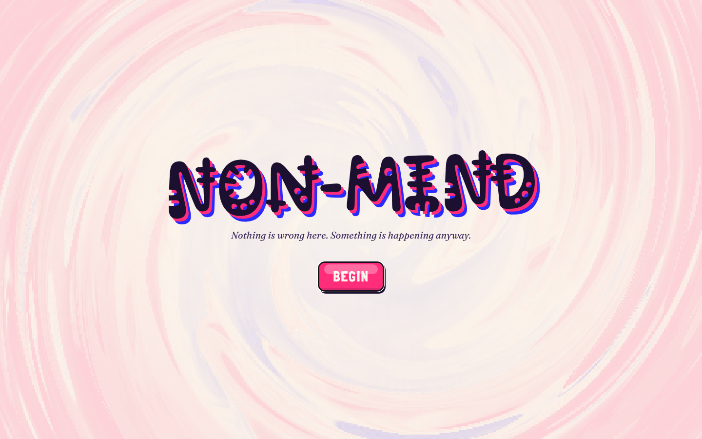
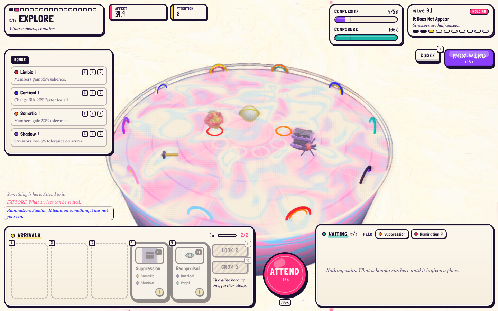
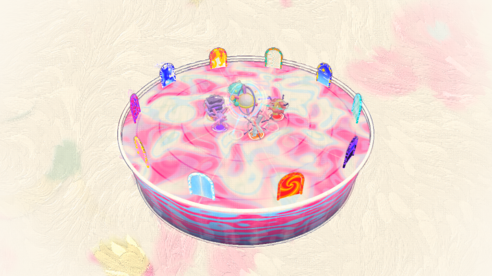
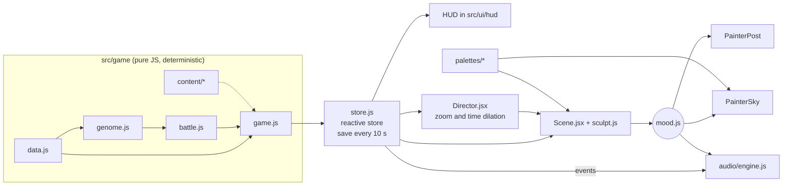

# NON-MIND

*An abstract 3D auto-battler and incremental about affect regulation and complexity, drawn as wet acrylic paint.*

This began as a quiet question: what would it look like to play a mind that keeps adding to itself? We wondered whether the thing a player collects could also be the thing that ends the run. We tried it, and kept the parts that held. What came out is a small glass vessel of painted sea with ten gates around the rim. Stressors arrive through them, ten beats to a wave, ten waves to a cycle. Regulators, which are defences in the language of affect science, sit around a glowing core and answer them. Each regulator is a genome tree, and its body is a sculpture compiled from that tree while the game runs. Complexity pays, then presses, then overwhelms, and the way out is a reset called non-mind.

Play it here: https://danmarc247.github.io/non-mind/

Source: https://github.com/danmarc247/non-mind

## Screenshots

Three moments from the live build.

| Title | Early battle | Mid game |
|---|---|---|
|  |  |  |

---

## Contents

1. What if?
2. How it feels to play
3. Mechanics reference
4. Genres it folds together
5. Tech stack
6. Architecture
7. Design system
8. How it was built
9. Development
10. Fonts and third-party licences
11. Roadmap

---

## What if?

The game is the trace of a few questions, asked one after another. Each answer below is what the code does now.

**What if complexity itself were the thing you collect, and also the thing that ends you?**
Complexity multiplies affect income (`x (1 + C/25)`) and feeds the strength of every regulator. Past capacity (`40 x (1 + 0.3 x stage)`) it turns into overwhelm: stressors grow tougher (up to 2.2 times), beats come faster, composure drains. The same number is both the reward and the pressure.

**What if a unit's body were grown from its ancestry, so that every joining and every parting made a shape no one had seen?**
A regulator is a binary tree of family genes joined by `blend` (integrate) or `carve` (subtract). The one tree sets its stats, its name, its aspects and its look. `sculpt.js` writes a Shader Park program from the tree, compiles it to GLSL at runtime and raymarches it, so a hybrid is the literal constructive solid geometry of its parents. Splitting writes the tree back into two bodies.

**What if getting better meant becoming simpler, until the best thing a unit can do is leave?**
Two identical genomes at the same link fuse into the next of twelve (from link 4 a copy one link away will do, so the climb turns from doubling to something closer to Fibonacci). The stat multiplier climbs from x1 to x150, and each link adds a heritable trait. Low links are knotted and muddy, high links are pale, luminous and plain, and link 12 dissolves the unit into a permanent ending. Each family has three forms along the way, raw, grown and refined, and every unit is a slightly different sibling of the others.

**What if each thing learned were a door, and the game began as one button?**
Eighteen stages, each unlocking one system: the shop, habits, integrate, repurpose, insight, split, a second ring, subtract, attendants, verbs, exchange, echo, stance, seasons, mirror, a wildcard, and finally non-mind. The conditions are things the player does, such as fusing, splitting and subtracting.

**What if the structure were small and strict, so the strangeness had somewhere to stand?**
One centre, ten gates, ten families, ten waves of ten beats, and a ten-step arc of modifiers that bends each wave in turn. These numbers never change. Everything else does.

**What if the music started as a few slow loops that never line up, and only later learned to run?**
At low complexity there are eight ambient loops with incommensurate periods of about 17 to 34 seconds, played by felt piano and wordless voice, each circling the listener in HRTF space. As complexity rises, interlocking arpeggio ostinati of different lengths enter and phase against each other. Under overwhelm the pulse speeds from 132 to 168 bpm, detunes and saturates. Everything is synthesized in the Web Audio API, and the mode changes with each prestige depth.

**What if the whole picture were wet paint that never dries?**
Sky, sea and a five-pass post chain render as acrylic: anisotropic Kuwahara strokes, impasto relief, canvas weave, ink edges. Eighteen stage palettes morph into one another. The sky switches on one more painted motif at every stage and wears one of ten compositions as the waves pass. The sea moves through seven movements (canvas, marbling, kaleidoscope, colonies, reaction, fold, flood) as the stages rise, and every game event drops paint on it. Overwhelm lets the paint run.

**What if the picture held more than the game needs?**
Around the vessel, bodies hang in the air and touch nothing: slow mobiles, paint slices below the glass, rising motes, and lines that almost connect them. The whole stage turns, faster with every stage, and a joining or a parting gives it a push that settles. The sculptures reflect a painted sky, and they lean toward whatever you point at.

**What if starting over were the reward?**
Non-mind turns peak complexity into permanent **residue**: more affect, stronger regulators, more starting attention. It is the exit that overwhelm was always pointing at.

---

## How it feels to play

The first minutes are small on purpose. One thing is on the screen, and it can be attended to.

### The first five minutes

| Step | Do this | What happens |
|---|---|---|
| 1 | Press the title button | Audio unlocks, the sea appears, the core pulses. |
| 2 | Click the **core** (or press `Space`) | Affect rises. Five clicks unlock the shop (stage 1). |
| 3 | Buy a regulator from the shop (cost equals its tier in attention) | It arrives and takes the first free seat, as long as there is room. If you hold nothing and cannot afford anything, something simple arrives on its own. |
| 4 | Move it if you prefer: click it, then click a **seat** ring | Swaps if occupied. With auto on, a wave starts about 5 seconds into prep. |
| 5 | Watch the wave | Stressors enter through gates and walk toward the core. Kills pay affect. A win pays attention and refreshes the shop. |
| 6 | Buy a second copy of the same family | The two **fuse** into link 2. This is the ladder, and the next stage opens integrate. |
| 7 | Keep going | Each stage hint in the log points at what to try next. If you go still for about 25 seconds, a quiet arrow and a line of text suggest one thing that can be done right now. |

A loss is not a wall. It pays 3 attention, refills composure, and each loss on a wave softens its stressors by 12 percent (`x0.88`, up to 12 stacks) until the wave is won.

Moments of realization (a fuse, an integrate, a new stage, an ending, a reset) are marked by a camera director: a soft zoom toward the thing, and time slowed for a breath. A stage unlock, a link of 5 or more, an ending, a wave's arc and a reset also get a short painted banner from the Ceremony overlay. The director leans on the camera and lets go. It never takes it away. The camera also turns slowly by itself, faster at every stage, and a fuse, integrate, subtract, split, new stage or reset gives the turning a push that settles.

### Controls

| Input | Action |
|---|---|
| Click the core, or `Space` | Attend |
| Hover a unit or a seat | It brightens and swells a little, so you can see what a click will take |
| Click a unit | Select it; the inspector shows genome, mutations, traits and operations |
| Click a seat | Place the selected unit (swaps if occupied) |
| Integrate / Subtract | Select a unit, press the operation, then click the second unit |
| `1` to `5` | Buy the shop slot with that number |
| `R` | Reroll the shop (2 attention) |
| `X` | Buy experience (5 attention for 4 xp) |
| `C` | Open or close the codex |
| `M` | Open or close this manual |
| `L` | Open or close the Lineage map |
| `?` or `H`, or the `?` ring | Ask for a hint: the next suggestion appears at once |
| `Esc` | Close the open panel, cancel a pending operation, or deselect |
| Drag, scroll | Orbit and zoom (distance 5 to 70, panning off) |

The shop keys work once the shop is unlocked. Typing in a box and open panels silence the game's hotkeys, and `Space` never presses a button that happens to have focus.

The ring of tools holds the codex, the manual, **save**, **lineage**, **again** (a confirmed wipe of everything, including residue) and **sound** (on or off, remembered). The save menu keeps the game now, copies it as a line of text, downloads it as a `.txt` file, or puts such a line back (a rejected code changes nothing). Apart from that the game saves to `localStorage` every 10 seconds.

The **Lineage** map is a paper folio drawn with PixiJS: every body you have grown this run, and what it grew from. It loads only while open.

On a phone the HUD becomes a slim top strip, the arena, and a bottom dock of tabs; there are no hotkeys or hover there.

---

## Mechanics reference

The rules, as the code currently states them. Constants live in `src/game/data.js`, `game.js` and `battle.js`. Some numbers are tuned often, so when this page and the code disagree, the code is right.

### Resources

| Resource | Source | Spent on |
|---|---|---|
| **Affect** | Attending, habits, kills, wave wins, `glad` and `transmute` | Habits, upgrades, attendants, mirrors |
| **Attention** | Wave wins (7 + interest + streak bonus up to 3), losses (3), selling, exchange. Starts at 3, plus up to 20 from residue (its square root) | Shop units (cost = tier), reroll (2), xp (5 for 4 xp) |
| **Insight** | Regenerates `1 + 0.15 x level` per second, capped at 100 once unlocked | Integrate (20), subtract (35), split (10), spells |
| **Composure** | Core health, 100. Refills 25% per win, fully after a loss | Lost to stressors reaching the core; zero loses the wave |
| **Residue** | Non-mind resets | Multiplies affect (`1 + 0.04 x residue`), strengthens regulators (`1 + 0.05 x residue^0.7` on tolerance and salience), adds starting attention |
| **Endings** | Link 12 dissolutions | +10% affect and +10% salience each, kept through resets |

Interest on attention is `floor(attention / 10)`, capped at 5 (10 with Thrift Of Attention). A won wave also pays 2 xp, a lost one 1 xp.

### Shop, levels and seats

The shop shows 5 slots, rolled again after every wave and on every reroll. Your level sets the odds of each tier, and the unit cap grows with it.

| Level | 1 | 2 | 3 | 4 | 5 | 6 | 7 | 8 | 9 | 10 |
|---|---|---|---|---|---|---|---|---|---|---|
| xp to reach the next | 2 | 3 | 6 | 10 | 16 | 26 | 40 | 60 | 90 | max |
| Tier 1 / 2 / 3 / 4 / 5 odds (%) | 100 / 0 / 0 / 0 / 0 | 80 / 20 / 0 / 0 / 0 | 65 / 30 / 5 / 0 / 0 | 50 / 35 / 15 / 0 / 0 | 38 / 35 / 24 / 3 / 0 | 28 / 33 / 30 / 8 / 1 | 20 / 28 / 34 / 15 / 3 | 15 / 22 / 33 / 24 / 6 | 12 / 18 / 28 / 30 / 12 | 8 / 14 / 24 / 34 / 20 |

From stage 3 the shop leans toward the family you are already climbing: each slot has a 30 percent chance to show the family of your highest-link regulator, so the ladder reads as a path and not a lottery. If you hold nothing, cannot afford the cheapest slot and cannot afford a reroll, a tier 1 family arrives in the first slot and you are given the attention for it.

### The 18 stages

| # | Stage | Unlocks | Condition, in plain words |
|---|---|---|---|
| 0 | appear | attend | Start |
| 1 | explore | shop | Attend 5 times |
| 2 | grow | habits | Reach wave 2, or 6 kills |
| 3 | combine | integrate | Fuse one link |
| 4 | repurpose | repurpose | Integrate once |
| 5 | increase | insight, spells | Own 8 habits |
| 6 | regroup | split | Reach wave 4 |
| 7 | expand | second ring | Level 4 |
| 8 | ingest | subtract | Split once |
| 9 | support | attendants | Subtract once |
| 10 | evoke | verbs | Finish a cycle, or reach wave 9 |
| 11 | interchange | exchange | Complete 2 verbs |
| 12 | evoke | echo | 3 exchanges (stage 10 and stage 12 share a name on purpose) |
| 13 | inhabit | stance | 10 echoes |
| 14 | sustain | seasons | Choose a stance |
| 15 | penetrate | mirror | Survive 5 seasons |
| 16 | embrace | wildcard aspect | Own a mirror |
| 17 | overwhelm | non-mind at full strength | Overwhelm reaches 1 |

Non-mind itself is available from stage 1; being fully overwhelmed (which unlocks stage 17) doubles the residue you get.

### The 10 families

One per gate. Tier sets shop rarity and cost.

| Family | Tier | Aspects | Ability | Text |
|---|---|---|---|---|
| Reappraisal | 1 | cortical, vagal | Reframe | It turns the thing over until the thing has another side. |
| Suppression | 1 | somatic, shadow | Lid | Nothing is happening. It will keep not happening, louder. |
| Rumination | 1 | cortical, limbic | Loop | Again. And the again of again. |
| Avoidance | 2 | void, somatic | Withdraw | It is excellent at being elsewhere. |
| Attunement | 2 | relational, vagal | Mend | It becomes the shape of what is near it, and that helps. |
| Projection | 3 | shadow, relational | Cast Out | It is certain the feeling belongs to someone over there. |
| Dissociation | 3 | void, shadow | Vanish | It watches itself from the ceiling. The view is fine. |
| Sublimation | 4 | mythic, limbic | Transmute | It sets fire to the thing and calls the light a career. |
| Containment | 4 | somatic, relational | Hold | It does not fix. It is a place where unfixed things may be. |
| Equanimity | 5 | mythic, void | Level | Applause and accusation arrive. It offers them both the same chair. |

Abilities fire when **charge** reaches 100. Charge fills 14 per strike (scaled by cortical and wave modifiers) and by damage taken. From stage 12 a unit also fires its second-heaviest gene's ability at half power (**echo**), if that gene is a different family.

| Ability | Effect |
|---|---|
| Reframe | The strongest stressor is turned on its nearest kin, and stunned |
| Lid | Keeps most of the harm it takes and hardens; returns it to those near when the unit falls |
| Loop | Strikes five times, and is worn by it |
| Withdraw | Leaps to the far rim, unseen a moment, and strikes thrice from there |
| Mend | Mends the ally who needs it most |
| Cast Out | Hands its own wounds to the nearest stressor, and is eased by it |
| Vanish | Returns beside the stressor with the most tolerance, heavily |
| Transmute | Burns everything near; the ashes are affect |
| Hold | Everything nearby must attend to it; it hardens |
| Level | Draws every stressor down toward the weakest; the greatest are drawn less |

Base stats per family live in `src/game/data.js` (for example Containment 2100 tolerance, Equanimity 260 salience and reach 6).

### Stats glossary

| Stat | Meaning | What it really does |
|---|---|---|
| **Tolerance** | Health | A unit that reaches 0 falls for the wave |
| **Salience** | Damage | Damage per strike, varied by lability |
| **Latency** | Seconds between strikes | Floor of 0.15 s |
| **Reach** | Range | Units advance until a target is within reach; stressors target units within reach + 2.2 |
| **Opacity** | % chance to be missed | Capped at 80 for units; `see` ignores it |
| **Lability** | Damage variance | A strike deals `salience x (1 +/- lability)` |
| **Recursion** | % chance to strike twice | Rolled each strike |

A **veil** is a damage shield that soaks harm before tolerance. Poles skew a gene: *idealized* (+1) is x0.6 tolerance, x1.7 salience, 0.85 latency; *devalued* (-1) is x1.5 tolerance, x0.7 salience.

### Aspects and thresholds

Each unit votes its genes' aspects (weighted by tree position) and keeps the top 2 (top 3 with four or more leaves). Seated units count once per distinct first-gene family. Thresholds are **2, 4 and 6** members for tiers 1 to 3. The wildcard (stage 16) adds one member to every aspect.

| Aspect | Tone | Tier 1 / 2 / 3 effect |
|---|---|---|
| Vagal | teal | Members mend 2 / 5 / 10 % of tolerance per second |
| Limbic | blood | Members gain 25 / 60 / 130 % salience |
| Cortical | ultra | Charge fills 20 / 45 / 90 % faster for all |
| Somatic | tangerine | Members gain 30 / 70 / 150 % tolerance |
| Shadow | violet | Stressors lose 8 / 16 / 30 % tolerance on arrival |
| Relational | rose | Members share 25 / 40 / 60 % of harm with neighbours |
| Void | ink | Members gain 12 / 25 / 45 opacity |
| Mythic | yolk | Affect from all sources +15 / 40 / 100 % |

### The ladder: 12 links

Two units of the same genome at the same link fuse into the next. From link 4 a unit also fuses with a copy one link away (that copy must be link 3 or more), and the result is one above the higher. Each link multiplies tolerance and salience and grants one heritable trait.

| Link | Name | x | Trait | Effect |
|---|---|---|---|---|
| 1 | Unsatisfactoriness | 1 | ache | Deals more the less tolerance it has left |
| 2 | Confidence | 1.7 | trust | Starts each wave with a veil worth a share of tolerance |
| 3 | Gladness | 2.8 | glad | Each strike yields a little affect |
| 4 | Rapture | 4.5 | rapture | First strikes of a wave come much faster |
| 5 | Tranquillity | 7 | calm | Slows the latency of stressors nearby |
| 6 | Ease | 11 | ease | Mends itself continuously |
| 7 | Collectedness | 17 | gather | Repeated strikes on one target grow |
| 8 | Seeing As It Is | 26 | see | Ignores opacity and veils |
| 9 | Disenchantment | 40 | tire | Stressors nearby lose salience |
| 10 | Dispassion | 62 | fade | Counts as every aspect |
| 11 | Release | 95 | release | On falling, mends every ally |
| 12 | Knowing The Ending | 150 | end | Dissolves into a permanent ending |

### Operations

A genome is a tree, maximum **6 leaves**. Beyond that the lightest leaves are pruned and survive as **ghosts**, a small stat residue that still counts toward complexity.

| Operation | Unlock | Cost | Result |
|---|---|---|---|
| **Integrate** | stage 3 | 20 insight | `blend` two units; link is the higher of the two; traits are unioned (cap 10) |
| **Subtract** | stage 8 | 35 insight | `carve` the second out of the first; carved genes weigh less; keeps the first's link |
| **Split** | stage 6 | 10 insight | Undo a node into its two children, each returning at the link its parent brought to the integrate (so joining then parting mints no link), or split a whole gene at link 2+ into an idealized and a devalued half at link minus 1 |
| **Repurpose** | stage 4 | free | Dissolve a unit into habits. The habit is chosen by worth: `tier - 1 + floor((link - 1) / 3)` indexes the ten habits. The count is `round(link x (1 + parts) / 2)`, at least 1, so a cheap unit never becomes a late habit |
| **Fuse** | automatic | free | Identical genome and link merge into link + 1 (from link 4, a neighbour link works too) |

```
leaf            Reappraisal                       one gene

integrate       blend( Reappraisal, Rumination )      one body, two parents
subtract        carve( Suppression, Avoidance )       "Hollowed" Suppression
deeper          blend( blend(A, B), C )               trees nest up to 6 leaves

split (node)    blend(A, B)                  ->  A  and  B  (same link)
split (whole)   Attunement, link 4           ->  Attunement+ and Attunement-, both link 3
split (node)    blend(A at 3, B at 1)        ->  A at link 3  and  B at link 1
fuse            Attunement L2 + Attunement L2  ->  Attunement L3, gains trait `glad`
fuse (L4+)      Attunement L4 + Attunement L3  ->  Attunement L5
```

Names are generated from the tree: heaviest gene is the noun, others become adjectives (`Ruminative Hollowed Suppression`).

### Waves, beats and the ten arc modifiers

A wave is 10 beats of 2.4 s (0.7x once overwhelm passes one half). Each beat spawns `1 + floor(gw / 4)` stressors at a gate (one more on every fifth beat, 1.5x while three Dreads are held, at most 14), where `gw` is the global wave number. Waves 1 to 10 cycle, then the cycle counter rises. Wave 10 (the Return arc) ends on a boss, and the four bosses take turns by cycle.

```
tolerance = base x 3.4 x 1.1^min(gw-1, 18) x 1.04^clamp(gw-19, 0, 10) x 1.015^max(0, gw-29)
            x (1 + 1.2 x overwhelm) x (1 + 0.2 x mirrors) x 0.88^habituation
salience  = base x 1.04^(gw-1)
```

| Wave | Arc | Modifier |
|---|---|---|
| 1 | It Does Not Appear | Stressors are half-unseen (opacity 35) |
| 2 | Beyond The Path Of Words | Charge fills at half speed |
| 3 | Just As | Each stressor arrives with its likeness: double the stressors at 0.55x tolerance |
| 4 | One, Therefore Many | One great stressor; when it falls it is many |
| 5 | Neither One Nor Two | Counts are unreliable |
| 6 | No Place, Every Place | They arrive through every gate at once |
| 7 | Same, Different | They wear the forms of your own; 1.3x salience |
| 8 | Equal In Number To Thoughts | Their number follows your attention (your clicks this wave) |
| 9 | Who Is Able | Aspect bonds are silent |
| 10 | Light Appears | A boss, and each strike you land has a 3 percent chance to take the target's whole remaining tolerance (the one-strike rule) |

Stressors: five base kinds (Intrusion, Deadline, Criticism, Ambiguity, Shame) and the boss Abandonment, plus an extended roster of eleven more (Clutter, Silence, Comparison, Obligation, Boredom, Hurry, Noise, Doubt, Loss, Lateness, Envy) and three later bosses (Expectation, Transition, Inadequacy). The ordinary pool widens with the global wave number, up to 16 kinds.

**Affixes.** From global wave 4 a stressor may carry one of 40 named distortions (Unread, Inherited, 3 A.M., Anticipated, Recurring, and so on), each a stat change with a minimum wave. The chance rises linearly from 0 at wave 3 to 70 percent at wave 40. Bosses carry none.

**Habituation.** Every loss on a wave multiplies the next attempt's stressor tolerance by `0.88`, up to 12 losses, so no wall is permanent. A win resets it to zero.

### Habits, upgrades, spells, verbs, moods

| Habit | Base cost | Yield / s |
|---|---|---|
| Breath | 10 | 0.2 |
| Pause | 120 | 1.5 |
| Naming | 900 | 9 |
| Routine | 7e3 | 55 |
| Journal | 6e4 | 380 |
| Ritual | 5.5e5 | 2.8e3 |
| Narrative | 6e6 | 2.2e4 |
| Schema | 8e7 | 2e5 |
| Myth | 1.2e9 | 2.1e6 |
| Identity | 2.5e10 | 2.6e7 |

Cost grows `x1.15` per owned. Inner Crowd adds `C / 60` to every regulator's salience multiplier. Eight upgrades (Noticing, Counting Breaths, Old Wound, Long View, Inner Crowd, Thrift Of Attention, Second Blow, Lending) and three insight spells (**Exhale**: every regulator mends a third and composure gains 20, **Name It**: double harm for 8 s, **Recollect**: 30 s of habit yield) are stage-gated. **Attendants** (300 x 2.2^n affect) click for you.

| Verb | Time | Needs | Result |
|---|---|---|---|
| Dream | 40 s | none | A regulator sleeps; a related family wakes |
| Ruminate | 25 s | cortical | +45 insight and a Dread (or, 30% of the time, Fascination) |
| Rest | 30 s | vagal | Removes a Dread, restores composure |
| Confide | 35 s | relational | A Contentment |

Moods decay: **Dread** (180 s; three of them open the gates wider, 1.5x stressors), **Contentment** (90 s; cancels one Dread), **Fascination** (180 s; 1.5x affect).

### Complexity, capacity, overwhelm, non-mind

```
unit complexity = (leaves + 0.5*depth + 0.5*ghosts) * (1 + 0.35*(link-1)) + 0.25*traits
C   = sum(units) + 1.2*sqrt(habits) + 1.5*upgrades + moods + 70*mirrors
      + 0.6*attendants + 3 if stance + 2.5*log10(1+earned) + 1.5*global wave
capacity  = 40 * (1 + 0.3 * stage)
overwhelm = clamp( (C - capacity) / (0.12 * capacity), 0, 1 )
affect x  = (1 + 0.04 residue) * (1 + C/25) * (1 + 0.1 endings) * 2^mirrors * aspect/upgrade/mood terms

non-mind: residue += floor( (peak C / 8)^0.8 * (1 + stage/17) * (2 if overwhelm >= 1) * (1 + 0.15 * depth) )
          keeps residue, endings, depth, best stage; everything else resets
```

The overwhelm band is narrow: from capacity to 12 percent above it. At overwhelm 1 composure drains 2% of max per second, and stressors are 2.2x tougher.

### Mutations

Every regulator can carry up to 6 heritable mutations, drawn from 72 (24, 22, 16 and 10 at rarities 1 to 4). Each is an affective-science idea turned oblique, with a stat modifier that pays a cost for its gift, and an **epithet** that joins the unit's name (the rarest one wins).

| Event | Mutation chance |
|---|---|
| Fuse into a new link | 60% |
| Integrate | 80% |
| Split | 50% for each half |
| Dream (verb) | 100% |

Rolls are weighted by `1 / rarity^2`, skip duplicates and skip conflicting pairs. Mutations pass to offspring: integrate unions the parents' sets, split deals them out alternately.

### Mirrors, stance, seasons

| System | Rule |
|---|---|
| **Mirror** | Cost `6e10 x 25^n` affect. Doubles affect, +2 unit cap, opens the third ring, +70 complexity, stressors +20% tolerance each |
| **Stance** | Toward: mending x2, reach x0.8. Away: opacity +20, reach x1.3, affect x0.8. Against: salience x1.6, tolerance x0.8 |
| **Seasons** | Every 60 s the season takes 3 attention, or, if you cannot pay, adds a Dread |
| **Exchange** | affect to attention, attention to insight (1 : 12), insight to attention (25 : 1), attention to affect |
| **Seats** | 3 rings of 10 (the second opens at stage 7, the third with a mirror). Unit cap `min(30, level + 1 + 2 x mirrors)`. Bench holds 8. New arrivals take the first free seat while there is room |

---

## Genres it folds together

Several familiar genres share a table here. Only their systems were borrowed, and each was changed on the way in.

| Genre system | NON-MIND system | What changed |
|---|---|---|
| Auto-battler drafting: shop, bench, board, level-gated odds, traits that need N members | Shop with 5 slots, tier odds by level, 3 seat rings, **aspect** thresholds 2 / 4 / 6 | Units are not fixed catalogue entries. Any two can be integrated or carved into a new genome, and merging copies climbs a 12-link ladder instead of a three-star cap. |
| Idle and incremental layering: buildings, prestige, a reset that multiplies the next run | Ten habits at x1.15 cost growth, the **non-mind** reset paying residue | The reset is driven by overwhelm, not a timer. Complexity both multiplies income and is the pressure that forces the reset. |
| Card-table occultism with timed verbs: slots, aspects, decaying moods | Verbs with aspect-gated slots, Dread / Contentment / Fascination, seasons | Verbs act on your own regulators, and aspects feed battle tiers as well as slots. |
| Unlock-by-progress tutorials | 18 stages, each unlocking one system | The unlock conditions are things you do (fuse, split, subtract), so the tutorial is the game. |

---

## Tech stack

The stack was chosen so one painted look could run in the browser without a server. Versions are those in `package.json`.

| Library | Link | Role here |
|---|---|---|
| Three.js 0.187 | https://threejs.org | Renderer, scene graph, custom `ShaderMaterial`s |
| React 19 | https://react.dev | UI and scene composition |
| React Three Fiber 9 | https://r3f.docs.pmnd.rs | React renderer for Three; the arena, sea, seats, fx |
| drei | https://drei.docs.pmnd.rs | `OrbitControls` |
| Shader Park (`shader-park-core`) | https://shaderpark.com | Compiles each genome's JS sculpture program to a GLSL raymarcher |
| lygia | https://lygia.xyz | GLSL noise (`snoise`, `psrdnoise`, `random`) in sea and sky shaders |
| postprocessing + @react-three/postprocessing | https://github.com/pmndrs/postprocessing | `EffectComposer`, custom painter effects, mipmap bloom |
| PixiJS 8 | https://pixijs.com | The Lineage map, loaded lazily and only while it is open |
| GSAP | https://gsap.com | Timelines for the Ceremony overlays (stage, ending, reset, arc banners) |
| marked | https://marked.js.org | Renders this README as the in-game Manual |
| Motion | https://motion.dev | HUD springs and presence |
| Tailwind CSS 4 | https://tailwindcss.com | Utility styling, `@theme` palette tokens |
| Pretext | https://github.com/chenglou/pretext | Text measuring and line layout for flowing type |
| three-text | https://github.com/countertype/three-text | 3D text engine for 3D type |
| @pmndrs/glyph | https://github.com/pmndrs/glyph | Glyph ticker text (isolated in a lazy canvas with DOM fallback) |
| kinetic-type-engine | https://www.npmjs.com/package/@andyed/kinetic-type-engine | Rapid-serial text flashes for the cryptic lines |
| React Bits | https://reactbits.dev | 14 ported WebGL backgrounds (raw WebGL2; OGL is not a dependency) |
| Aceternity UI | https://ui.aceternity.com | Glow, encrypted text, spotlight cards and more (ported) |
| Cult UI | https://www.cult-ui.com | Texture cards and buttons, lens blur (ported) |
| lucide-react, clsx, tailwind-merge, class-variance-authority, @radix-ui/react-slot, simplex-noise, harfbuzzjs, woff-lib | npm | Icons, class utilities, noise, font tooling |
| @fontsource packages | https://fontsource.org | Self-hosted fonts |
| Vite 8 | https://vite.dev | Dev server and build, `vite-plugin-glsl` (`vite-plugin-singlefile` is installed but not enabled) |
| Vitest 5 | https://vitest.dev | 192 engine tests in node, run in CI before every deploy |
| Web Audio API | https://developer.mozilla.org/docs/Web/API/Web_Audio_API | All music and SFX, no samples and no libraries |

---

## Architecture

The engine knows nothing of pixels or sound. Everything else reads its state and its events.



### Genome to shader pipeline

1. A unit is `{ g, link, traits, ghosts, muts }`; `g` is a tree of `leaf` and `node` records.
2. `treeSrc` walks the tree. Each leaf emits a Shader Park form for its family (lens, slab, knot, shard, rings, spike, shell, flame, bowl, orbit) in one of three growth stages (raw for links 1 to 4, grown 5 to 8, refined 9 to 12), jittered by a seed from the genome, mutations and unit id so siblings differ, coloured by family and link grade.
3. Each node emits `blend(k)`, `difference()` or `mixGeo(k)`, a displacement and a rotation, then the second child.
4. `unitSource` wraps it: low links get a domain-warp "knot", high links gain halo rings (`floor(link / 3)`).
5. `sculptToThreeJSShaderSource` turns the program into vertex and fragment GLSL.
6. `compile` swaps in a custom `main()`: quantised light bands, a paper-white rim, hit flash, dither fade, and `gl_FragDepth` written from the hit point so sculptures sort correctly against the sea and each other.
7. Materials are cached by `key(g)|link`, so identical genomes share a shader.
8. The result is drawn on a unit sphere per body; if compilation fails it falls back to a sphere.

### Render pipeline

| Layer | What | Where |
|---|---|---|
| Sky | Painted dome: flow-warped strokes, drifting rings (more as complexity rises), one more motif switched on at each stage, ten wave compositions that cross-fade as the wave changes, palette shifting by stage and rotated by depth | `PainterSky.jsx`, `glsl/sky.*` |
| Sea | Contained vessel: seven movements (canvas, marbling, kaleidoscope, colonies, reaction, fold, flood) cross-fade with the stage; events drop ripples; cut-face strata | `gfx/sea/`, `glsl/sea2.*` |
| Arena | Gate portals, seat rings, core aura, sea caustics, glass vessel | `gfx/arena/`, `glsl/arena.*` |
| Drift | Floating bodies that touch nothing: mobiles, paint strata below the vessel, rising motes, tethers between bodies | `gfx/drift/`, `glsl/drift.*` |
| Sculptures | Core, regulators, stressors, raymarched, with `gl_FragDepth`; three growth-stage forms per family, seeded siblings, a painted sky reflected in each, a spark under the pointer | `sculpt.js` |
| Fx | Paint marks per game event (pools of 192 ground, 64 ribbon, 640 air, 16 invert) and one of ten veils per wave-arc modifier | `gfx/fx/`, `glsl/fx.*` |
| Post chain | 1 Kuwahara, 2 Relief, 3 Bloom, 4 Grade, 5 Overwhelm; one pass each, `mergeMode="none"` | `PainterPost.jsx`, `glsl/post.*` |

The post stages: anisotropic generalized Kuwahara (4 sectors, structure tensor); impasto height with bristle line-integral lighting, canvas weave and ink edges (reads depth), preceded inside the same pass by a detachment stage (tilt-shift soft focus, a paper halo and ink line around near silhouettes, aerial perspective) that lifts the arena off the far picture; low bloom pumped by flashes; a filmic grade with a torn paper vignette; and the overwhelm pass (wobble, chroma smear, posterise, splashes, drips, whiteout). Quality presets are `low`, `med`, `high`.

### Director

`Director.jsx` also sets the camera's auto-turn speed (`0.35 + 0.11 x stage`, faster under overwhelm, plus a decaying push on joining, parting, new stages and resets). It listens to game events (link, integrate, subtract, split, mutation, repurpose, ending, stage, wave result, boss arrival, reset, first attend). Each maps to a zoom fraction, a hold time and a time scale (as low as 0.2 for an ending). The camera eases toward the focus, then lets go, with a slow breathing dolly in between. Player orbiting is preserved because the changes are applied as relative offsets.

### The mood contract

`src/gfx/mood.js` is a plain mutable object written once per frame by the game loop and read by every shader and the audio engine: `time, complexity, overwhelm, tension, depth, stage, wave, cycle, flash, audio {low, mid, high, rms}`. The canvas is `linear legacy flat`, so every shader writes display sRGB itself. No React re-renders at 60 Hz.

### Audio graph

```
music voices -> HRTF panners -> ambient and arpeggio buses + reverb sends -> musicSum
drone / breath / Shepard glide -> musicDry -> musicSum
ping-pong delay (relational) -> musicSum
musicSum -> [clean | tanh drive] -> tilt shelves -> collapse lowpass -> duck -> musicGain
sfx voices -> (HRTF) -> sfxDry + sfx reverb -> sfxGain
master -> mute -> compressor -> makeup -> soft clip -> analyser -> out
```

| Layer | Behaviour |
|---|---|
| Ambient loops | 8 loops, periods about 17 to 34 s (incommensurate), felt piano and wordless voice, each orbiting the listener in HRTF space |
| Arpeggios | 5 plucked ostinati of 6, 8, 5, 7 and 9 notes, entering as complexity rises, each lengthening and shortening by a note every few cycles so they phase; two more of 11 and 13 notes join under overwhelm |
| Overwhelm | Tempo 132 to 168 bpm, detune, saturation, a rising Shepard glissando |
| Aspects and stance | Colour the mix: vagal breath, somatic heartbeat, shadow bends the drone, mythic adds a choir fifth, relational adds ping-pong delay |
| Depth | Eight modes and keys cycle with prestige depth |
| Reset | About 2 s collapse to a single tone, then regrowth |
| SFX | 32 named procedural effects, pitched to the current mode, budgeted at 48 oscillators; a sound ring mutes everything |

### Directory map

```
src/
  game/        data.js genome.js battle.js game.js store.js index.js   (the engine; no DOM)
               advisor.js (idle suggestions) savecode.js (export and import codec)
    content/   mutations, stressor affixes, names, cryptic line pools  (authored text)
  gfx/         Scene.jsx sculpt.js mood.js PainterSky.jsx PainterPost.jsx
    glsl/      sea.* sky.* post.*
    palettes/  stages.js (18 stage palettes) families.js (family + link grade + aspect tones)
    arena/ fx/ drift/ sea/ Director.jsx                               (vessel parts, paint fx, floating bodies, the sea, camera)
    galleries/ one development page per area
  audio/       engine.js music.js instruments.js sfx.js util.js lab.js
  ui/          Hud.jsx  bits/ (HUD kit + backgrounds/)  hud/ (panels, codex, tutorial, nudges)  type/ (typography)
               Lineage.jsx lineage/ (PixiJS map)  Ceremony.jsx  SaveMenu.jsx  Manual.jsx
  index.css    palette and font tokens
tests/         game/ (vitest + balance probe)  audio/ (offline render harness, run by hand)
docs/          TEAM.md team-log.md
```

---

## Design system

The reference was three acrylic paintings and nothing else. The rule that followed was to keep one small set of colours and let motion carry the rest.

Paper ground, ink line, saturated accents, never a dark sci-fi UI. The only colours are the tokens below; a new colour is a mix of tokens.

| Token | Hex | Role |
|---|---|---|
| paper | `#fbf6ec` | Ground, panel face, rims, foam |
| paper-2 | `#f3ead9` | Second panel tone |
| ink | `#1b1030` | Outlines (3 px), text, shadows, stressor bodies |
| ink-2 | `#3a2a5c` | Secondary text |
| magenta | `#ff2d7a` | Primary accent, selection |
| ultra | `#2a2bff` | Insight, XP, cortical |
| yolk | `#ffd21f` | Attention, buttons, core glow, tier 5 |
| tangerine | `#ff7a1a` | Somatic, repurpose |
| teal | `#17b5a6` | Vagal, integrate, health |
| violet | `#8a3ffc` | Shadow, split |
| blood | `#e3262f` | Limbic, subtract, danger |
| leaf | `#2fbf4a` | Late-stage accent |
| rose | `#ff9ecf` | Relational |
| sky | `#8fd3ff` | Thin washes |

| Font | Role |
|---|---|
| Kablammo | Titles |
| Londrina Solid / Outline | Headings |
| Hypermonosaturation | Numbers and stats (lowercase only) |
| Fraunces | Body text |

Stage palettes (`stages.js`) hold 18 entries with five hue slots each. Neighbouring stages change at most two slots; the 16 to 17 collapse to white is the one exception. Link grade runs from muddy and knotted at link 1 to pale and luminous at link 12. Motion is soft but quick: springs for panels, a pop on every hotkey press, and degradation (shake, smear) as overwhelm rises.

---

## How it was built

The game was made by a team of models with one mediator, each in its own lane.

A small agent team with one mediator.

| Role | Model | Lanes |
|---|---|---|
| Mediator | Fable | Architecture, contracts, engine, genome-to-shader pipeline, arena, integration, git |
| Opus lanes | Opus | Sky, post chain, HUD kit, audio engine, HUD, arena, paint fx, drift, sea, sculpture forms, Lineage map, research |
| Support | Sonnet | Backgrounds, tests and balance, content tables, save menu |
| Minis | Haiku | Palettes |

Protocol: brief, work and self-verify, hand back a short report, cross-lane needs go through `docs/team-log.md` (`from -> to: need`), the mediator integrates. Nobody edits outside their lane; only the mediator touches git, npm and config. Contracts: `src/gfx/mood.js`, `src/game/index.js`, `src/index.css`. Details in [`docs/TEAM.md`](docs/TEAM.md) and [`docs/team-log.md`](docs/team-log.md).

---

## Development

Everything runs locally with Node.

```bash
npm i --legacy-peer-deps      # install
npm run dev                   # vite dev server, port 5173
npm run build                 # production build to dist/ (base './', hosted under /non-mind/)
npm test                      # 192 tests (vitest, node environment); CI runs this before the build
```

Parallel dev servers need separate caches: `NM_CACHE_DIR=/tmp/cache-x npx vite --port 5181 --strictPort`.

Pushes to `main` run the tests, then build and deploy to GitHub Pages through `.github/workflows`.

### Galleries (development only)

Each area has a gallery page at the repository root for checking it alone. They are part of the dev server, not of the deployed build (`vite build` ships `index.html` only), so they have no public address. To open one, run `npm run dev` and visit `http://localhost:5173/<name>.html` (or the port you chose).

| Page | Shows |
|---|---|
| `scene-gallery.html` | The full arena with a bot playing, for scene checks |
| `sky-gallery.html` | The painted sky dome |
| `post-gallery.html` | The painter post chain and quality levels |
| `sea-gallery.html` | The contained sea and its seven movements |
| `arena-gallery.html` | Gate portals, seat rings, core aura, glass vessel |
| `fx-gallery.html` | Paint fx and the ten arc veils |
| `drift-gallery.html` | Floating bodies, strata, motes, tethers |
| `sculpt-gallery.html` | Every family form, growth stage, sibling and stressor |
| `bits-gallery.html` | The HUD kit (panels, buttons, meters, cards, tooltips) |
| `bits-backgrounds.html` | The 14 background shaders |
| `hud-gallery.html` | HUD panels |
| `lineage-gallery.html` | The Lineage map |
| `save-gallery.html` | The save menu |
| `type-gallery.html` | Typography components (flash, flow, 3D, glyph ticker) |
| `audio-lab.html` | Audio bench: mood sliders, aspects, every SFX |

### Headless simulation

The engine has no DOM, so a bot can play it in node:

```js
import('./src/game/game.js').then(({ simulate }) => {
  const G = simulate(1800, 1);            // 30 simulated minutes, seed 1
  console.log(G.stage, G.wave, G.complexity);
});
```

`node tests/game/balance.mjs` runs 10 seeds across several resets, prints stage, wave and complexity over time, and ends with goal lines (G1 to G7) marked PASS or FAIL. Audio renders offline with `node tests/audio/render.cjs <url>`.

---

## Fonts and third-party licences

Credit where it is due.

| Asset | Source | Licence |
|---|---|---|
| Hypermonosaturation | fontspace, by heaven castro | Freeware |
| Kablammo, Londrina Solid / Outline, Fraunces | Fontsource | SIL Open Font License |
| Aceternity UI components (GlowingEffect, EncryptedText, TextGenerateEffect, MovingBorder, NoiseBackground, CardSpotlight, CanvasRevealEffect, WavyBackground) | https://ui.aceternity.com, by Manu Arora | Aceternity License: end products allowed, no redistribution of the components themselves |
| Cult UI components (TextureCard, TextureButton, MinimalCard, NeumorphButton, ShaderLensBlur) | https://www.cult-ui.com | MIT, Copyright (c) 2023 Jordan-Gilliam |
| React Bits backgrounds | https://reactbits.dev | MIT with Commons Clause, per the upstream repo |

See `src/ui/bits/README.md` and `src/ui/bits/backgrounds/README.md` for ports and changes. Game text, names and content are original.

---

## Roadmap

What has changed since the first version, and what has not.

### Done since the first version

- Save export and import: a copied line of text or a `.txt` file, with a checksum, and a menu to save now or wipe.
- More sculpture forms: three growth-stage forms per family, seeded siblings, six axes of mutation-driven deformation, a reflective painted finish.
- The per-event cryptic line pools are wired into the log, with idle and overwhelm lines in between.
- The idle libraries are used or gone: PixiJS draws the Lineage map, GSAP runs the Ceremony overlays (mounted, lazily loaded), and OGL and zustand were removed.
- Idle hints and the question button, from a pure advisor module in the engine.
- The contained sea, paint fx and wave veils, the arena parts and the floating bodies, each as its own folder.
- Bundle splitting has begun: `vite.config.js` groups vendor code (React, three, the R3F family, Shader Park, Motion, GSAP) into chunks, and `src/App.jsx` loads the scene, the Ceremony, the Manual, the save menu and the Lineage map lazily. The largest chunk is still about 740 kB (190 kB gzip), the warning limit stays raised, and the Lineage map's PixiJS chunk loads only when opened.

### Still ahead

- Mobile and touch layout: in progress. A phone HUD exists (`src/ui/hud/Mobile.jsx`: a top strip, the arena, a bottom dock of tabs opening a bottom sheet, attend under the right thumb), but the codex and manual are not yet comfortable at narrow widths.
- Contrast and reduced-motion passes across the HUD (the Ceremony already respects reduced motion).
- Further bundle trimming: the entry and scene code could be split more finely.
- The gallery pages are development-only, with no public address. That is by design, but it means the deployed site shows none of them.

### Balance

The late-stage balance was tuned (stressor scaling, pay, mirror cost, a neighbour fuse from link 4, shop leaning, the xp table, a narrower overwhelm band), and it is still being refined. The latest run of `node tests/game/balance.mjs` reports, honestly:

- G1 fail: stage 17 reached in 10 of 10 seeds, median 23.4 minutes (target 25 to 45), and the largest gap between stages after minute 5 is longer than wanted.
- G2 pass: each seed buys 1 to 3 mirrors before stage 17.
- G3 pass: the wildcard aspect adds a median of 4 aspect tiers.
- G4 fail: win rate by window is 96, 52, 83, 89 and 78 percent (target 55 to 90 in every window).
- G5 pass: affect never outruns the top price by more than 1000 times.
- G6 fail: the highest link in the first run is 5 to 7 (target 6 to 9), and no seed reaches an ending by run 3.
- G7 fail: later runs reach stage 17 faster (about 42 percent, inside the target), but the residue gained does not rise from run to run (75, 73, 84).
