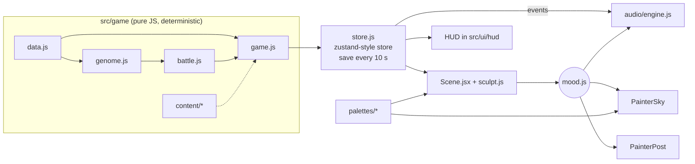

# NON-MIND

**An abstract 3D auto-battler and incremental about affect regulation and complexity, rendered as living acrylic paint.**

You tend a small mind inside a glass vessel of painted sea. Ten gates ring the rim. Stressors walk in through them, ten beats to a wave, ten waves to a cycle. You seat regulators (defences, in the language of affect science) around a glowing core and let them fight. Every regulator is a **genome tree** whose body is a **raymarched SDF sculpture compiled at runtime**, so every merge, carve and split grows a form nobody has seen. Complexity pays you, arms you, and then drowns you. When it is too much, you let go. That reset is called **non-mind**, and it makes the next run wider.

**Play it: https://danmarc247.github.io/non-mind/**

Repo: https://github.com/danmarc247/non-mind

---

## Contents

1. [Why this has not been done](#why-this-has-not-been-done)
2. [How to play](#how-to-play)
3. [Mechanics reference](#mechanics-reference)
4. [Genres it folds together](#genres-it-folds-together)
5. [Tech stack](#tech-stack)
6. [Architecture](#architecture)
7. [Design system](#design-system)
8. [How it was built](#how-it-was-built)
9. [Development](#development)
10. [Fonts and third-party licences](#fonts-and-third-party-licences)
11. [Roadmap](#roadmap)
12. [Screenshots](#screenshots)

---

## Why this has not been done

| | The idea | What it means concretely |
|---|---|---|
| a | **Complexity is currency, reward and threat** | Complexity multiplies your affect income (`x (1 + C/25)`), but once it passes capacity you are overwhelmed: stressors toughen, beats speed up, composure drains. The only exit is a reset called **non-mind**, which converts your peak complexity into permanent `mu`. |
| b | **Units are genome trees with generated bodies** | A regulator is a binary tree of family genes joined by `blend` (integrate) or `carve` (subtract). The same tree drives its stats, its name, its aspects and its 3D body. `sculpt.js` writes a Shader Park program from the tree, compiles it to GLSL at runtime and raymarches it. A hybrid is the literal CSG of its parents. |
| c | **A 12-link ladder as the upgrade path** | Two identical genomes at the same link fuse into the next link. Stat multiplier runs from x1 to x150, each link adds a heritable trait, and **link 12 dissolves the unit** into a permanent ending. |
| d | **An 18-stage loop where each stage unlocks one system** | Shop, habits, integrate, repurpose, insight, split, outer ring, subtract, attendants, verbs, exchange, echo, stance, seasons, mirror, wildcard, non-mind. The game starts as one button. |
| e | **A formal skeleton** | One centre, ten gates, ten families, ten waves of ten beats, and a ten-step rhetorical arc that modifies each wave in turn. |
| f | **Music that follows complexity** | Asynchronous ambient loops at low complexity give way to interlocking minimalist arpeggios as it rises, then to a faster, saturated, detuned pulse under overwhelm. All of it is synthesized in the Web Audio API, spatialised with HRTF, and tuned to a different mode on every prestige depth. |
| g | **The scene is wet paint** | Sky, sea and post chain all render acrylic: anisotropic Kuwahara strokes, impasto relief, canvas weave, ink edges. Eighteen stage palettes morph with progress, and overwhelm makes the paint run. |

---

## How to play

### The first five minutes

| Step | Do this | What happens |
|---|---|---|
| 1 | Press the title button | Audio unlocks, the sea appears, the core pulses. |
| 2 | Click the **core** | You attend. Affect rises. Five clicks unlock the shop (stage 1). |
| 3 | Buy a regulator from the shop (costs attention equal to its tier) | A unit appears on the bench. |
| 4 | Click it, then click a glowing **seat** ring | It is seated. With auto on, a wave starts about 5 seconds into prep. |
| 5 | Watch the wave | Stressors enter through gates and walk toward the core. Kills pay affect. A win pays attention and refreshes the shop. |
| 6 | Buy a second copy of the same family | The two **fuse** into link 2. That is the ladder, and it unlocks integrate. |
| 7 | Keep going | Each stage hint (shown in the log) tells you what to do next. |

### Controls

| Input | Action |
|---|---|
| Click the core | Attend (main income early on) |
| Click a unit | Select it; the inspector shows genome, traits and operations |
| Click a seat | Place the selected unit (swaps if occupied) |
| Integrate / Subtract | Select a unit, press the operation, then click the second unit |
| Drag, scroll | Orbit and zoom the camera (distance 12 to 34, panning off) |
| `R` | Reroll the shop (2 attention) |
| `X` | Buy experience (5 attention for 4 xp) |

The HUD is in active development, so more hotkeys will be listed here when they land. The game saves to `localStorage` every 10 seconds.

---

## Mechanics reference

### Resources

| Resource | Source | Spent on |
|---|---|---|
| **Affect** | Attending, habits, kills, wave wins, `glad` and `transmute` | Habits, upgrades, attendants, mirrors |
| **Attention** | Wave wins (4 + interest + streak bonus), selling, exchange. Starts at 3, plus up to 20 from `mu` | Shop units (cost = tier), reroll, xp |
| **Insight** | Regenerates `1 + 0.15 x level` per second, capped at 100 once unlocked | Integrate (20), subtract (35), split (10), spells |
| **Composure** | Core health, 100. Refills 25% per win | Lost to stressors reaching the core; zero loses the wave |
| **mu** | Non-mind resets | Multiplies affect (`1 + 0.04 mu`), strengthens regulators, adds starting attention |
| **Endings** | Link 12 dissolutions | +10% affect and +10% salience each, kept through resets |

Interest on attention is `floor(attention / 10)`, capped at 5 (10 with Thrift Of Attention).

### The 18 stages

| # | Stage | Unlocks | Condition, in plain words |
|---|---|---|---|
| 0 | appear | attend | Start |
| 1 | explore | shop | Attend 5 times |
| 2 | grow | habits | Reach wave 2, or 6 kills |
| 3 | combine | integrate | Fuse one link |
| 4 | repurpose | repurpose | Integrate once |
| 5 | increase | insight, spells | Own 8 habits |
| 6 | regroup | split | Reach wave 5 |
| 7 | expand | second ring | Level 5 |
| 8 | ingest | subtract | Split once |
| 9 | support | attendants | Subtract once |
| 10 | evoke | verbs | Finish a cycle, or reach wave 9 |
| 11 | interchange | exchange | Complete 2 verbs |
| 12 | evoke | echo | 3 exchanges |
| 13 | inhabit | stance | 5 echoes |
| 14 | sustain | seasons | Choose a stance |
| 15 | penetrate | mirror | Survive 3 seasons |
| 16 | embrace | wildcard aspect | Own a mirror |
| 17 | overwhelm | non-mind (double mu) | Overwhelm reaches 1 |

Non-mind itself is available from stage 1; stage 17 only doubles the mu you get while overwhelmed.

### The 10 families

One per gate. Tier sets shop rarity and cost.

| Family | Tier | Aspects | Ability | Text |
|---|---|---|---|---|
| Reappraisal | 1 | cortical, vagal | Reframe | It turns the thing over until the thing has another side. |
| Suppression | 1 | somatic, shadow | Lid | Nothing is happening. It will keep not happening, louder. |
| Rumination | 1 | cortical, limbic | Loop | Again. And the again of again. |
| Avoidance | 2 | void, somatic | Withdraw | It is excellent at being elsewhere. |
| Attunement | 2 | relational, vagal | Mend | It becomes the shape of what is near it, and that helps. |
| Projection | 3 | shadow, relational | Cast Out | It is certain the feeling belongs to someone over there. |
| Dissociation | 3 | void, shadow | Vanish | It watches itself from the ceiling. The view is fine. |
| Sublimation | 4 | mythic, limbic | Transmute | It sets fire to the thing and calls the light a career. |
| Containment | 4 | somatic, relational | Hold | It does not fix. It is a place where unfixed things may be. |
| Equanimity | 5 | mythic, void | Level | Praise and blame arrive. It offers them both the same chair. |

Abilities fire when **charge** reaches 100. Charge fills 14 per strike (scaled by cortical and wave modifiers) and by damage taken. From stage 12 a unit also fires its second-heaviest gene's ability at half power (**echo**).

| Ability | Effect |
|---|---|
| Reframe | The target strikes its own kind once |
| Lid | Stores harm taken, returns all of it when the unit falls |
| Loop | Strikes five times, and feels each |
| Withdraw | Leaps to the far rim, strikes thrice |
| Mend | Heals the ally who needs it most |
| Cast Out | Hands its wounds to the nearest stressor |
| Vanish | Blinks behind the strongest, hits hard |
| Transmute | Burns everything near; ashes become affect |
| Hold | Taunts and hardens |
| Level | Pulls stressors toward the weakest's tolerance |

Base stats per family live in `src/game/data.js` (for example Containment 2100 tolerance, Equanimity 260 salience and reach 6).

### Stats glossary

| Stat | Meaning | What it really does |
|---|---|---|
| **Tolerance** | Health | A unit that reaches 0 falls for the wave |
| **Salience** | Damage | Damage per strike, varied by lability |
| **Latency** | Seconds between strikes | Floor of 0.15 s |
| **Reach** | Range | Units advance until a target is within reach; stressors target units within reach + 2.2 |
| **Opacity** | % chance to be missed | Capped at 80 for units; `see` ignores it |
| **Lability** | Damage variance | A strike deals `salience x (1 +/- lability)` |
| **Recursion** | % chance to strike twice | Rolled each strike |

A **veil** is a damage shield that soaks harm before tolerance. Poles skew a gene: *idealized* (+1) is x0.6 tolerance, x1.7 salience, 0.85 latency; *devalued* (-1) is x1.5 tolerance, x0.7 salience.

### Aspects and thresholds

Each unit votes its genes' aspects (weighted by tree position) and keeps the top 2 (top 3 with four or more leaves). Seated units count once per distinct first-gene family. Thresholds are **2, 4 and 6** members for tiers 1 to 3. The wildcard (stage 16) adds one member to every aspect.

| Aspect | Tone | Tier 1 / 2 / 3 effect |
|---|---|---|
| Vagal | teal | Members mend 2 / 5 / 10 % of tolerance per second |
| Limbic | blood | Members gain 25 / 60 / 130 % salience |
| Cortical | ultra | Charge fills 20 / 45 / 90 % faster for all |
| Somatic | tangerine | Members gain 30 / 70 / 150 % tolerance |
| Shadow | violet | Stressors lose 8 / 16 / 30 % tolerance on arrival |
| Relational | rose | Members share 25 / 40 / 60 % of harm with neighbours |
| Void | ink | Members gain 12 / 25 / 45 opacity |
| Mythic | yolk | Affect from all sources +15 / 40 / 100 % |

### The ladder: 12 links

Two units of the same genome at the same link fuse into the next. Each link multiplies tolerance and salience and grants one heritable trait.

| Link | Name | Gloss | x | Trait | Effect |
|---|---|---|---|---|---|
| 1 | Dukkha | unsatisfactoriness | 1 | ache | Deals more the less tolerance it has left |
| 2 | Saddhā | confidence | 1.7 | trust | Starts each wave with a veil worth a share of tolerance |
| 3 | Pāmojja | gladness | 2.8 | glad | Each strike yields a little affect |
| 4 | Pīti | rapture | 4.5 | rapture | First strikes of a wave come much faster |
| 5 | Passaddhi | tranquillity | 7 | calm | Slows stressors nearby |
| 6 | Sukha | ease | 11 | ease | Mends itself continuously |
| 7 | Samādhi | collectedness | 17 | gather | Repeated strikes on one target grow |
| 8 | Yathābhūta | seeing as it is | 26 | see | Ignores opacity and veils |
| 9 | Nibbidā | disenchantment | 40 | tire | Stressors nearby lose salience |
| 10 | Virāga | dispassion | 62 | fade | Counts as every aspect; cannot be dysregulated |
| 11 | Vimutti | release | 95 | release | On falling, mends every ally |
| 12 | Khaye ñāṇa | knowing the ending | 150 | end | Dissolves into a permanent ending |

### Operations

A genome is a tree, maximum **6 leaves**. Beyond that the lightest leaves are pruned and survive as **ghosts**, a small stat residue that still counts toward complexity.

| Operation | Unlock | Cost | Result |
|---|---|---|---|
| **Integrate** | stage 3 | 20 insight | `blend` two units; link is the higher of the two; traits are unioned (cap 10) |
| **Subtract** | stage 8 | 35 insight | `carve` the second out of the first; carved genes weigh less; keeps the first's link |
| **Split** | stage 6 | 10 insight | Undo a node into its two children at the same link, or split a whole gene at link 2+ into an idealized and a devalued half at link minus 1 |
| **Repurpose** | stage 4 | free | Dissolve a unit into habits of its first family's gate |
| **Fuse** | automatic | free | Identical genome and link merge into link + 1 |

```
leaf            Reappraisal                       one gene

integrate       (Reappraisal + Rumination)        blend: a hybrid, one body

subtract        (Suppression - Avoidance)         carve: Hollowed Suppression

        integrate            integrate
 Reappraisal ----+                   +---- Rumination
                 v                   v
              blend(  Reappraisal , Rumination  )
                 |
                 +--- integrate with Containment --->  blend( blend(R, R'), C )

split (node)    blend(A, B)        ->  A  and  B
split (whole)   Attunement link 4  ->  Attunement+ (idealized) and Attunement- (devalued), both link 3
fuse            Attunement L2 + Attunement L2  ->  Attunement L3, gains trait `trust`... of link 3 (`glad`)
```

Names are generated from the tree: heaviest gene is the noun, others become adjectives (`Ruminative Hollowed Suppression`).

### Waves, beats and the ten arc modifiers

A wave is 10 beats of 2.4 s (0.7x under heavy overwhelm). Each beat spawns stressors at a gate. Waves 1 to 10 cycle, then the cycle counter rises. Wave 10 (and the Return arc) ends on the boss. Stressor tolerance scales `1.15^(wave-1)`, salience `1.1^(wave-1)`, further by overwhelm and mirrors. At most 14 spawn per beat.

| Wave | Arc | Modifier |
|---|---|---|
| 1 | It Does Not Appear | Stressors are half-unseen (opacity 35) |
| 2 | Beyond The Path Of Words | Charge fills at half speed |
| 3 | Just As | Double the stressors at 0.55x tolerance |
| 4 | One, Therefore Many | One great stressor; when it falls it is many |
| 5 | Neither One Nor Two | Counts are unreliable |
| 6 | No Place, Every Place | They arrive through every gate |
| 7 | Same, Different | They wear your forms; 1.3x salience |
| 8 | Equal In Number To Thoughts | Their number follows your clicks |
| 9 | Who Is Able | Aspect bonds are silent |
| 10 | Light Appears | A boss, and a single strike may undo a great one |

Stressors: Intrusion, Deadline, Criticism, Ambiguity, Shame, and the boss Abandonment. The pool widens with global wave number up to five.

### Habits, upgrades, spells, verbs, moods

| Habit | Base cost | Yield / s |
|---|---|---|
| Breath | 10 | 0.2 |
| Pause | 120 | 1.5 |
| Naming | 900 | 9 |
| Routine | 7e3 | 55 |
| Journal | 6e4 | 380 |
| Ritual | 5.5e5 | 2.8e3 |
| Narrative | 6e6 | 2.2e4 |
| Schema | 8e7 | 2e5 |
| Myth | 1.2e9 | 2.1e6 |
| Identity | 2.5e10 | 2.6e7 |

Cost grows `x1.15` per owned. Eight upgrades (Noticing, Counting Breaths, Old Wound, Long View, Inner Crowd, Thrift Of Attention, Second Arrow, Lending) and three insight spells (**Exhale**: heal a third, **Name It**: double harm for 8 s, **Recollect**: 30 s of habit yield) are stage-gated. **Attendants** (300 x 2.2^n affect) click for you.

| Verb | Time | Needs | Result |
|---|---|---|---|
| Dream | 40 s | none | A regulator sleeps; a related family wakes |
| Ruminate | 25 s | cortical | +45 insight and a Dread (or, 30% of the time, Fascination) |
| Rest | 30 s | vagal | Removes a Dread, restores composure |
| Confide | 35 s | relational | A Contentment |

Moods decay: **Dread** (180 s; three of them open the gates wider, 1.5x stressors), **Contentment** (90 s; cancels one Dread), **Fascination** (180 s; 1.5x affect).

### Complexity, capacity, overwhelm, non-mind

```
unit complexity = (leaves + 0.5*depth + 0.5*ghosts) * (1 + 0.35*(link-1)) + 0.25*traits
C   = sum(units) + 1.2*sqrt(habits) + 1.5*upgrades + moods + 12*mirrors
      + 0.6*attendants + 3 if stance + 2.5*log10(1+earned) + 1.2*global wave
capacity  = 40 * (1 + 0.3 * stage)
overwhelm = clamp( (C - capacity) / (0.35 * capacity), 0, 1 )
affect x  = (1 + 0.04 mu) * (1 + C/25) * (1 + 0.1 endings) * 2^mirrors * aspect/upgrade/mood terms

non-mind: mu += floor( (peak C / 8)^0.8 * (1 + stage/17) * (2 if overwhelm >= 1) )
          keeps mu, endings, depth, best stage; everything else resets
```

At overwhelm 1 composure drains 2% of max per second, and stressors are up to 3x tougher.

### Mirrors, stance, seasons

| System | Rule |
|---|---|
| **Mirror** | Cost `1e6 x 40^n` affect. Doubles affect, +2 unit cap, opens the third ring, +12 complexity, stressors +50% tolerance each |
| **Stance** | Toward: mending x2, reach x0.8. Away: opacity +20, reach x1.3, affect x0.8. Against: salience x1.6, tolerance x0.8 |
| **Seasons** | Every 60 s the season takes 3 attention, or, if you cannot pay, adds a Dread |
| **Exchange** | affect to attention, attention to insight (1 : 12), insight to attention (25 : 1), attention to affect |
| **Seats** | 3 rings of 10. Unit cap `min(30, level + 1 + 2 x mirrors)`. Bench holds 8 |

---

## Genres it folds together

Systems only, remixed, never copied.

| Genre system | NON-MIND system | What changed |
|---|---|---|
| Auto-battler drafting: shop, bench, board, level-gated odds, traits that need N members | Shop with 5 slots, tier odds by level, 3 seat rings, **aspect** thresholds 2 / 4 / 6 | Units are not fixed catalogue entries. Any two can be integrated or carved into a new genome, and merging copies climbs a 12-link ladder instead of a three-star cap. |
| Idle and incremental layering: buildings, prestige, a reset that multiplies the next run | Ten habits at x1.15 cost growth, the **non-mind** reset paying mu | The reset is driven by overwhelm, not a timer. Complexity both multiplies income and is the pressure that forces the reset. |
| Card-table occultism with timed verbs: slots, aspects, decaying moods | Verbs with aspect-gated slots, Dread / Contentment / Fascination, seasons | Verbs act on your own regulators, and aspects feed battle tiers as well as slots. |
| Unlock-by-progress tutorials | 18 stages, each unlocking one system | The unlock conditions are things you do (fuse, split, subtract), so the tutorial is the game. |

---

## Tech stack

| Library | Link | Role here |
|---|---|---|
| Three.js 0.187 | https://threejs.org | Renderer, scene graph, custom `ShaderMaterial`s |
| React 19 | https://react.dev | UI and scene composition |
| React Three Fiber 9 | https://r3f.docs.pmnd.rs | React renderer for Three; the arena, sea, seats, fx |
| drei | https://drei.docs.pmnd.rs | `OrbitControls` |
| Shader Park (`shader-park-core`) | https://shaderpark.com | Compiles each genome's JS sculpture program to a GLSL raymarcher |
| lygia | https://lygia.xyz | GLSL noise (`snoise`, `psrdnoise`, `random`) in sea and sky shaders |
| postprocessing + @react-three/postprocessing | https://github.com/pmndrs/postprocessing | `EffectComposer`, custom painter effects, mipmap bloom |
| OGL | https://github.com/oframe/ogl | Powers ported background shaders |
| PixiJS 8 | https://pixijs.com | 2D canvas effects |
| GSAP | https://gsap.com | Timeline animation |
| Motion | https://motion.dev | HUD springs and presence |
| Tailwind CSS 4 | https://tailwindcss.com | Utility styling, `@theme` palette tokens |
| Pretext | https://github.com/chenglou/pretext | Text measuring and line layout for flowing type |
| three-text | https://github.com/countertype/three-text | 3D text engine for 3D type |
| @pmndrs/glyph | https://github.com/pmndrs/glyph | Glyph ticker text (isolated in a lazy canvas with DOM fallback) |
| kinetic-type-engine | https://www.npmjs.com/package/@andyed/kinetic-type-engine | Rapid-serial text flashes for the cryptic lines |
| React Bits | https://reactbits.dev | 14 ported WebGL backgrounds |
| Aceternity UI | https://ui.aceternity.com | Glow, encrypted text, spotlight cards and more (ported) |
| Cult UI | https://www.cult-ui.com | Texture cards and buttons, lens blur (ported) |
| Zustand, lucide-react, clsx, tailwind-merge, cva, simplex-noise, harfbuzzjs, woff-lib | npm | State, icons, class utilities, noise, font tooling |
| Vite 8 | https://vite.dev | Dev server and build, `vite-plugin-glsl`, `vite-plugin-singlefile` |
| Vitest 5 | https://vitest.dev | Engine tests in node |
| Web Audio API | https://developer.mozilla.org/docs/Web/API/Web_Audio_API | All music and SFX, no samples and no libraries |

---

## Architecture



### Genome to shader pipeline

1. A unit is `{ g, link, traits, ghosts }`; `g` is a tree of `leaf` and `node` records.
2. `treeSrc` walks the tree. Each leaf emits a Shader Park form for its family (lens, slab, knot, shard, rings, spike, shell, flame, bowl, orbit), coloured by family and link grade.
3. Each node emits `blend(k)`, `difference()` or `mixGeo(k)`, a displacement and a rotation, then the second child.
4. `unitSource` wraps it: low links get a domain-warp "knot", high links gain halo rings (`floor(link / 3)`).
5. `sculptToThreeJSShaderSource` turns the program into vertex and fragment GLSL.
6. `compile` swaps in a custom `main()`: quantised light bands, a paper-white rim, hit flash, dither fade, and `gl_FragDepth` written from the hit point so sculptures sort correctly against the sea and each other.
7. Materials are cached by `key(g)|link`, so identical genomes share a shader.
8. The result is drawn on a unit sphere per body; if compilation fails it falls back to a sphere.

### Render pipeline

| Layer | What | Where |
|---|---|---|
| Sky | Painted dome: flow-warped strokes, drifting rings (more as complexity rises), palette rotated by depth | `PainterSky.jsx`, `glsl/sky.*` |
| Sea | Contained vessel: flow-warped bands of the stage palette, foam rings and ten spokes, cut-face strata | `Scene.jsx`, `glsl/sea.*` |
| Sculptures | Core, regulators, stressors, raymarched, with `gl_FragDepth` | `sculpt.js` |
| Fx | Instanced strokes, splats and rings per game event (220 max) | `Scene.jsx` |
| Post chain | 1 Kuwahara, 2 Relief, 3 Bloom, 4 Grade, 5 Overwhelm; one pass each, `mergeMode="none"` | `PainterPost.jsx`, `glsl/post.*` |

The post stages: anisotropic generalized Kuwahara (4 sectors, structure tensor); impasto height with bristle line-integral lighting, canvas weave and ink edges (reads depth); low bloom pumped by flashes; a filmic grade with a torn paper vignette; and the overwhelm pass (wobble, chroma smear, posterise, splashes, drips, whiteout). Quality presets are `low`, `med`, `high`.

### The mood contract

`src/gfx/mood.js` is a plain mutable object written once per frame by the game loop and read by every shader and the audio engine: `time, complexity, overwhelm, tension, depth, stage, flash, audio {low, mid, high, rms}`. No React re-renders at 60 Hz.

### Audio graph

```
music voices -> HRTF panners -> airDry/floeDry + reverb sends -> musicSum
drone / breath / Shepard glide -> musicDry -> musicSum
ping-pong delay (relational) -> musicSum
musicSum -> [clean | tanh drive] -> tilt shelves -> collapse lowpass -> duck -> musicGain
sfx voices -> (HRTF) -> sfxDry + sfx reverb -> sfxGain
master -> mute -> compressor -> makeup -> soft clip -> analyser -> out
```

| Layer | Behaviour |
|---|---|
| Ambient loops | 8 loops, periods about 17 to 34 s (incommensurate), felt piano and wordless voice, each orbiting the listener in HRTF space |
| Arpeggios | 5 plucked ostinati of 6, 8, 5, 7 and 9 notes, entering as complexity rises, each lengthening and shortening by a note every few cycles so they phase; two more of 11 and 13 notes join under overwhelm |
| Overwhelm | Tempo 132 to 168 bpm, detune, saturation, a rising Shepard glissando |
| Aspects and stance | Colour the mix: vagal breath, somatic heartbeat, shadow bends the drone, mythic adds a choir fifth, relational adds ping-pong delay |
| Depth | Eight modes and keys cycle with prestige depth |
| Reset | About 2 s collapse to a single tone, then regrowth |
| SFX | 28 named procedural effects, pitched to the current mode, budgeted at 48 oscillators |

### Directory map

```
src/
  game/        data.js genome.js battle.js game.js store.js index.js   (the engine; no DOM)
    content/   koans.js mutations.js stressors.js names.js             (authored text pools)
  gfx/         Scene.jsx sculpt.js mood.js PainterSky.jsx PainterPost.jsx
    glsl/      sea.* sky.* post.*
    palettes/  stages.js (18 stage palettes) families.js (family + link grade + aspect tones)
    galleries/ scene.jsx sky.jsx post.jsx
  audio/       engine.js music.js instruments.js sfx.js util.js lab.js
  ui/          bits/ (HUD kit + backgrounds/)  hud/ (panels)  type/ (typography)
  index.css    palette and font tokens
tests/         game/ (vitest + balance probe)  audio/ (offline render harness)
docs/          TEAM.md team-log.md
```

---

## Design system

The look is a vivid abstract acrylic painting you can play. Paper ground, ink line, saturated accents, never a dark sci-fi UI. The only colours are the tokens below; a new colour is a mix of tokens.

| Token | Hex | Role |
|---|---|---|
| paper | `#fbf6ec` | Ground, panel face, rims, foam |
| paper-2 | `#f3ead9` | Second panel tone |
| ink | `#1b1030` | Outlines (3 px), text, shadows, stressor bodies |
| ink-2 | `#3a2a5c` | Secondary text |
| magenta | `#ff2d7a` | Primary accent, selection |
| ultra | `#2a2bff` | Insight, XP, cortical |
| yolk | `#ffd21f` | Attention, buttons, core glow, tier 5 |
| tangerine | `#ff7a1a` | Somatic, repurpose |
| teal | `#17b5a6` | Vagal, integrate, health |
| violet | `#8a3ffc` | Shadow, split |
| blood | `#e3262f` | Limbic, subtract, danger |
| leaf | `#2fbf4a` | Late-stage accent |
| rose | `#ff9ecf` | Relational |
| sky | `#8fd3ff` | Thin washes |

| Font | Role |
|---|---|
| Kablammo | Titles |
| Londrina Solid / Outline | Headings |
| Hypermonosaturation | Numbers and stats (lowercase only) |
| Fraunces | Body text |

Stage palettes (`stages.js`) hold 18 entries with five hue slots each. Neighbouring stages change at most two slots; the 16 to 17 collapse to white is the one exception. Link grade runs from muddy and knotted at link 1 to pale and luminous at link 12. Motion is soft but quick: springs for panels, a pop on every hotkey press, and degradation (shake, smear) as overwhelm rises.

---

## How it was built

A small agent team with one mediator.

| Role | Model | Lanes |
|---|---|---|
| Mediator | Fable | Architecture, contracts, engine, genome-to-shader pipeline, arena, integration, git |
| Opus lanes | Opus | Sky, post chain, HUD kit, audio engine, HUD, research |
| Support | Sonnet | Backgrounds, tests and balance, content tables |
| Minis | Haiku | Palettes |

Protocol: brief, work and self-verify, hand back a short report, cross-lane needs go through `docs/team-log.md` (`from -> to: need`), the mediator integrates. Nobody edits outside their lane; only the mediator touches git, npm and config. Contracts: `src/gfx/mood.js`, `src/game/index.js`, `src/index.css`. Details in [`docs/TEAM.md`](docs/TEAM.md) and [`docs/team-log.md`](docs/team-log.md).

---

## Development

```bash
npm i --legacy-peer-deps      # install
npm run dev                   # vite dev server, port 5173
npm run build                 # production build to dist/ (base './', hosted under /non-mind/)
npx vitest run                # engine tests (node environment, tests/**/*.test.js)
```

Parallel dev servers need separate caches: `NM_CACHE_DIR=/tmp/cache-x npx vite --port 5181 --strictPort`.

Pushes to `main` build and deploy to GitHub Pages through `.github/workflows`.

### Galleries (dev server pages)

| Page | Shows |
|---|---|
| `/scene-gallery.html` | The full arena with a bot playing, for scene checks |
| `/sky-gallery.html` | The painted sky dome |
| `/post-gallery.html` | The painter post chain and quality levels |
| `/bits-gallery.html` | The HUD kit (panels, buttons, meters, cards, tooltips) |
| `/bits-backgrounds.html` | The 14 background shaders |
| `/type-gallery.html` | Typography components (flash, flow, 3D, glyph ticker) |
| `/audio-lab.html` | Audio bench: mood sliders, aspects, every SFX |

### Headless simulation

The engine has no DOM, so a bot can play it in node:

```js
import('./src/game/game.js').then(({ simulate }) => {
  const G = simulate(1800, 1);            // 30 simulated minutes, seed 1
  console.log(G.stage, G.wave, G.complexity);
});
```

`node tests/game/balance.mjs` runs 10 seeds across several resets and prints stage, wave and complexity over time. Audio renders offline with `node tests/audio/render.cjs <url>`.

---

## Fonts and third-party licences

| Asset | Source | Licence |
|---|---|---|
| Hypermonosaturation | fontspace, by heaven castro | Freeware |
| Kablammo, Londrina Solid / Outline, Fraunces | Fontsource | SIL Open Font License |
| Aceternity UI components (GlowingEffect, EncryptedText, TextGenerateEffect, MovingBorder, NoiseBackground, CardSpotlight, CanvasRevealEffect, WavyBackground) | https://ui.aceternity.com, by Manu Arora | Aceternity License: end products allowed, no redistribution of the components themselves |
| Cult UI components (TextureCard, TextureButton, MinimalCard, NeumorphButton, ShaderLensBlur) | https://www.cult-ui.com | MIT, Copyright (c) 2023 Jordan-Gilliam |
| React Bits backgrounds | https://reactbits.dev | MIT with Commons Clause, per the upstream repo |

See `src/ui/bits/README.md` and `src/ui/bits/backgrounds/README.md` for ports and changes. Game text, names and content are original.

---

## Roadmap

Built and in the repo, not yet wired into the live game:

- [ ] Content pools in `src/game/content/`: 72 heritable mutations, 40 stressor affixes plus 14 extra stressors, and short cryptic line pools per event
- [ ] Full HUD assembly (`src/ui/Hud.jsx`) and the complete hotkey set
- [ ] Mobile and touch layout pass
- [ ] Balance pass on late stages (mirrors, wildcard) using `tests/game/balance.mjs`
- [ ] Cloud-free save export and import
- [ ] More sculpture forms and mutation-driven deformation of bodies

---

## Screenshots

<!-- Images will be added under docs/screenshots/. Planned: title, arena mid-wave, a deep hybrid sculpture, overwhelm, each stage palette. -->

*Coming soon.*
